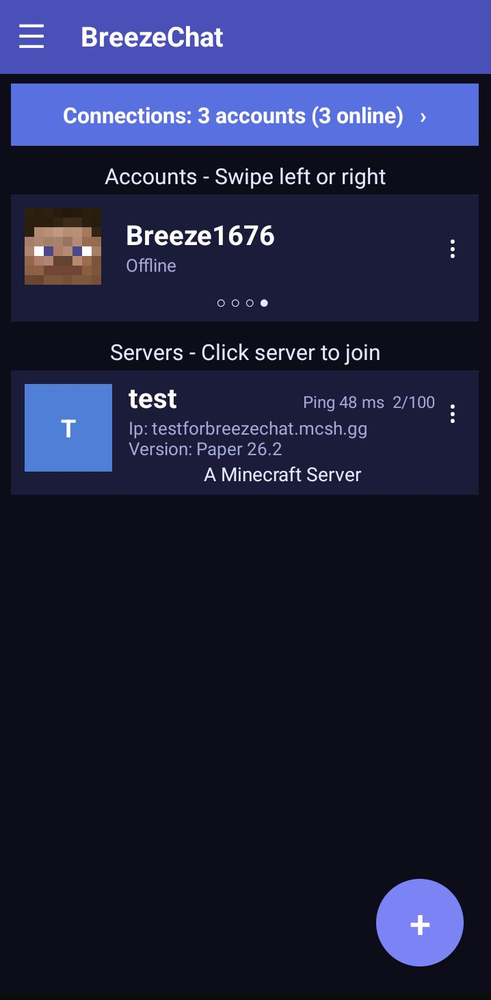
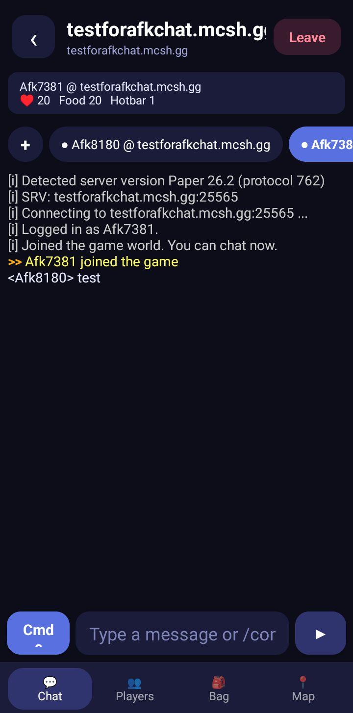
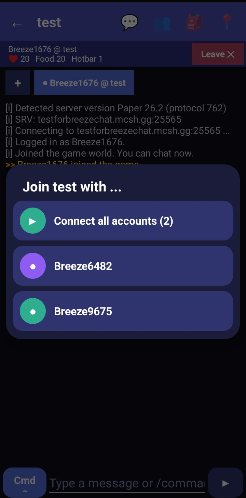
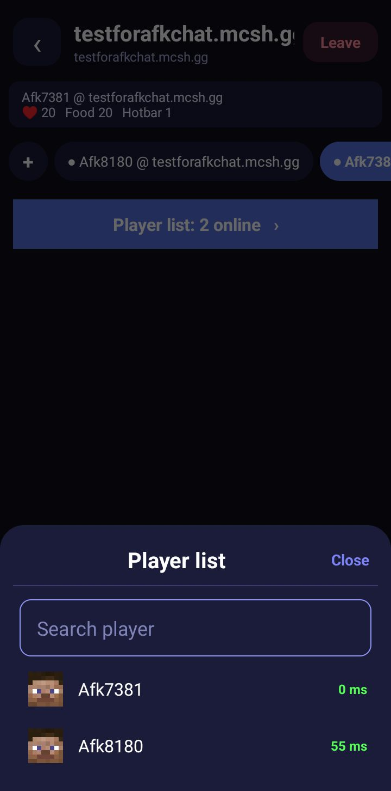
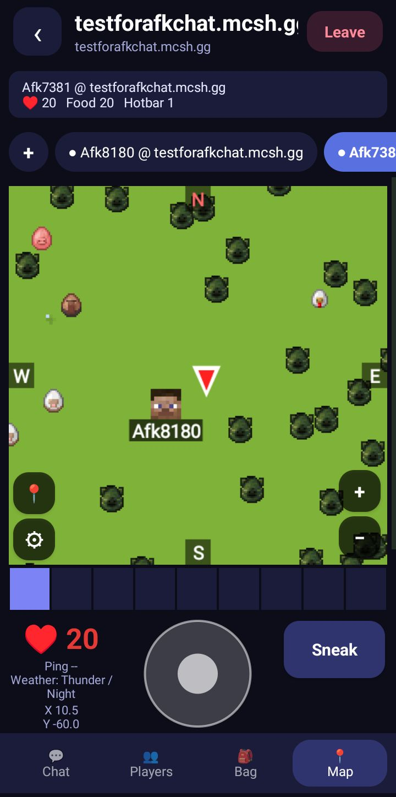
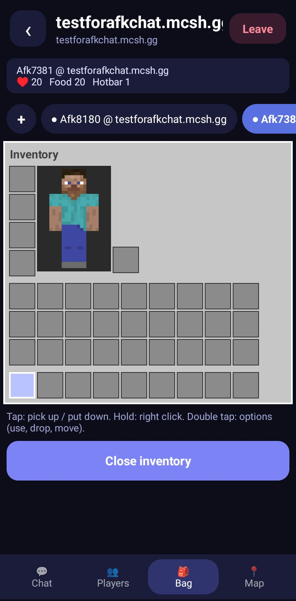
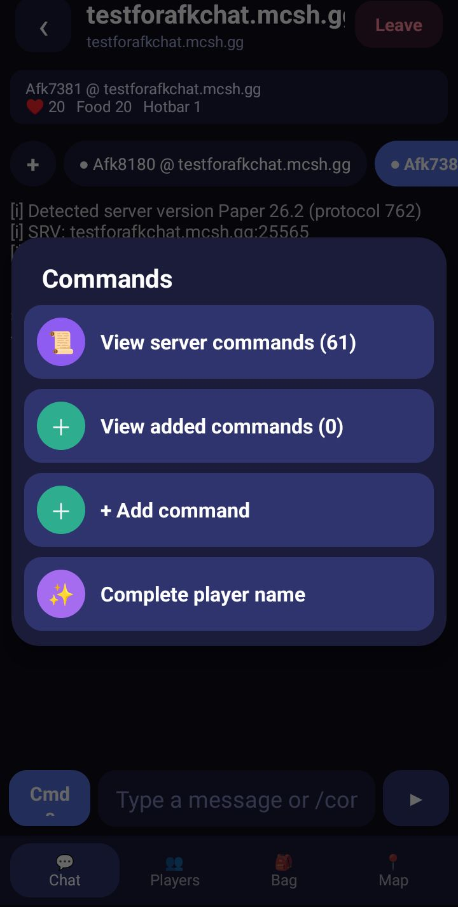

# 🌬️ BreezeChat

**Stay in your Minecraft server chat from your phone. No game needed.**

BreezeChat is a lightweight Minecraft: Java Edition chat client for Android. Join servers, chat, keep several accounts online in the background and look around on a live minimap, all with very little battery and data.

> Beta software, fan-made. Not affiliated with, endorsed by, or connected to Mojang or Microsoft.

> **Not to be confused with** other projects named "BreezeChats" on GitHub. This is a Minecraft: Java Edition chat client for Android and has nothing to do with them.

---

## 🤖 Made with AI (please read)

BreezeChat is **vibe-coded** ("slop-coded", if you like). Almost all of the code was written by an AI assistant ([Claude](https://claude.ai) by Anthropic). The maintainer ([@gembiltoo](https://github.com/gembiltoo)) comes up with the features, sends bug reports and screenshots, and tests every build on a real phone and real servers. The whole app is built on an Android phone, with no PC.

What that means for you:

- 🐛 **Expect bugs.** It is normal to find bugs, since everything is made on a phone. The code has not had a professional review or a security audit, and not every feature has been tried on every server.
- 🔐 **Look before you trust it with an account.** Online accounts sign in on the official Microsoft device-code page, and BreezeChat never sees your Microsoft password. Offline-account passwords (used for automatic `/login`) are stored only on your phone. BreezeChat has no ads and no analytics of its own. It only talks to Minecraft servers, Microsoft/Mojang sign-in, GitHub (the update check) and a free web translation service when you translate a chat line.
- 🔍 **The source is small and readable.** It is plain Java in a few files. Read it, break it, fix it.
- 🤝 **Issues and pull requests are welcome**, from humans and from AIs.

---

## ✨ Features

**Chat**
- 💬 Chat and commands, chat filter, join commands, repeating message, tappable links and clickable server messages
- 🔎 **Cmds menu**: search the server's own command list, or save your own commands (use `{player}` for a player's name)
- ⚡ **Quick commands**: your own buttons (`/home`, `/spawn`, `/sell all` ...). `{pos}` becomes your coordinates
- 🕐 Optional **time before every chat line**
- 🔔 **Chat alerts**: vibrate when someone says your name or a word you chose (for example `restart, event`)
- 🙉 Press and hold a chat line to **reply (/msg)**, **ignore** that player, **translate** it (Indonesian or English) or copy it
- 👥 Full tab list with ping and game mode, plus **search in the player list**

**Accounts and staying online**
- 👤 Many accounts at once: offline and Microsoft, connect or leave them all in one tap
- 🌙 Background mode, auto login, auto respawn, **auto reconnect** (waits longer after each failed try; no retry on bans or whitelists)
- ⏰ **Schedule account**: pick accounts (or all), pick servers (or all), and a time, and BreezeChat connects them for you. Set the time as a delay (`2d 5h 30min 10s`: s = seconds, min = minutes, h = hours, d = days, m = months) or on a date with the month by name (for example 7 November, 19:30). View, edit or delete schedules from the ☰ menu. Keep BreezeChat running or connected, because schedules only start while the app is alive
- 🛡️ **Anti-kick AFK** with a method you choose: Jump, Swing arm, Sneak, Walk, Turn or Quiet
- 📊 **Session stats**: online time, distance walked, deaths, messages, reconnects, biome and world

**Map and movement**
- 🗺️ **Live minimap** with detailed biome colours (smooth borders), hill shading, water depth, nearby players and mobs, zoom, a smooth arrow that shows where you look
- 🧭 **Explored map memory**: areas you have seen stay on the map (dimmed) and are saved on your phone, per server and per world
- 📍 **Waypoints**: save places, see them on the minimap with name and distance (an arrow at the edge when far away), walk to them
- ☠️ **Death point**: a waypoint is saved where you die, so you can walk back for your items
- 🌀 **Portal coordinates**: Overworld ↔ Nether conversion with one tap
- 🏃 Joystick or buttons, look pad, sneak toggle, auto jump, follow a nearby player, optional **tap map to walk**
- 🌊 Simple water physics (sink, swim, wade) so acid, lava and swimming behave like the game

**Inventory and trading**
- 🎒 Java-style inventory with your character, armor, held item, durability bars and leather armor colours
- 📦 **Open chests, barrels, ender chests and shulker boxes from the map**, with **Take all**, **Quick stack** and **Put backpack** buttons
- 🧑‍🌾 **Trade with villagers from the map**: tap one on the minimap, pick a trade, BreezeChat fills the items for you
- 🧰 Mini inventory and hotbar under the map

**App**
- ☰ Side menu (quick commands, stats, alerts, settings, help) and a **home screen shortcut** for any server with its icon
- 🎨 Colourful UI, 7 languages (English, Indonesian, Spanish, Portuguese, French, German, Russian) and 5 themes (Indigo, AMOLED black, Forest, Crimson, Ocean)
- 💾 Backup of accounts, servers, waypoints and quick commands to a folder, restore after reinstalling
- 🔔 Update notice when a new version is out

## 📸 Screenshots

| | |
|---|---|
|  **Main menu.** Your accounts (swipe left or right), your servers with ping and player count, and a **Connections** bar showing every running session. The **+** button adds a server. The **☰ button at the top left** opens the other menus: quick commands, session stats, chat alerts, settings and help. |  **Chat.** Chat and commands with the **Cmd** button. Each account has its own tab, and **+** adds another account. **Press and hold a message** for a menu: reply (/msg), ignore the player, translate (Indonesian or English), copy. |
|  **Join a server.** Tap a server and choose which account joins, or **Connect all accounts** to bring them all online. |  **Player list.** Everyone online with ping, and a search box to find a player fast. **Tap a player** for a menu: send a private message, follow, request teleport (/tpa), copy the name, or run your own saved commands (use `{player}` for their name). |
|  **Map and movement.** Live minimap with players and mobs, zoom, waypoints (📍) and minimap settings (⚙), hotbar, joystick, sneak, and a pad to look around. |  **Inventory.** Armor, your character, off hand, backpack and hotbar. Tap to pick up or put down, hold to right click, double tap for options. |
|  **Commands.** Browse the server's own command list, save your own commands, or complete a player name. |  |

## 🎮 Supported versions

| Server version | How it works |
|---|---|
| 1.19.4, 1.20, 1.20.1 | Native support, full features |
| 1.19 – 26.1 (all other versions) | Connects as 1.19.4. Works on servers that accept older clients (ViaVersion / ViaBackwards) |

Pick the server's version in the server form. If a server refuses the connection, it most likely does not accept older clients.

## 📲 Download and install

1. Open the [**Releases**](https://github.com/gembiltoo/BreezeChat/releases) page and download the newest `.apk`.
2. Open the file. Android may ask you to allow installing apps from your browser or file manager.
3. Open BreezeChat. The app is in **English** at first; change it in **⚙ Settings → Language**.

## 🚀 Quick start

1. On the home screen, swipe the account card to the last card (**+**) and add an account:
   - **Offline**: any name, for offline-mode ("cracked") servers. You can store a password for automatic `/login`.
   - **Online (Microsoft)**: sign in on the official `microsoft.com/link` page with the code shown.
2. Tap the **+** button and add a server: name, address, version, and the Forge switch if the server needs it.
3. Tap the server card to join. You can join the same server with several accounts.
4. Open **Connections** to see every running session, reconnect or leave them.

## 🕹️ Using the game screen

The top bar has four tabs: 💬 chat, 👥 players, 🎒 inventory, 📍 map and movement.

- **Chat**: type a message or a `/command`. **Cmds** opens saved commands and the server's command list. Press and hold a chat line for reply, ignore, translate or copy.
- **Players**: tap a player to send a private message, follow, `/tpa` or run your saved commands. The **Player list** button at the top searches every online player.
- **Inventory**: tap an item to use it, hold it, place it or drop it. Server menus (a compass, a shop) appear here. Chests opened from the map get the **Take all / Quick stack / Put backpack** buttons.
- **Map**: tap a chest, barrel or villager to open it or trade. **📍** (left of the map) opens waypoints, **⚙** opens Minimap settings (AFK method, players and mobs, joystick, auto jump, auto respawn, tap to walk, zoom), **+ / −** zoom.

## 🔋 Staying online in the background

Some phones (Samsung, Xiaomi and others) stop apps that run in the background, and the server then disconnects you with "Timed out". In **Settings → Stay connected in the background**, open the battery list and set BreezeChat to **Unrestricted**. Keep the notification visible: it has **Open** and **Leave all** buttons.

## 🛠️ Build it yourself

BreezeChat is a set of plain Java files, made to be built in an Android app builder on a phone.

1. Create a project with the package name **`com.breezechat.gem`**.
2. Put the Java files (`BreezeAuth`, `BreezeBlocks`, `BreezeChatUI`, `BreezeClient`, `BreezeItems`, `BreezeLang`, `BreezeService`) in the project's `java` folder.
3. Register `com.breezechat.gem.BreezeService` as a service in the AndroidManifest and add the permissions: INTERNET, FOREGROUND_SERVICE, POST_NOTIFICATIONS, WAKE_LOCK and VIBRATE (VIBRATE is only for chat alerts).
4. From the main activity, create `BreezeChatUI` and show its view (see `BreezeChatUI.build()`), and pass shortcut extras (`bc_srv`, `bc_acc`) to it.

## ⚠️ Known limitations

- Schedules need the app to stay alive in the background (see below). If the app was closed for more than 10 minutes past the start time, the schedule is marked as missed.
- Native features are 1.19.4 – 1.20.1. Other versions need a server that accepts older clients.
- It is a chat client, not a game launcher. There is no 3D view. Movement is simplified, so on uneven terrain, water or fences the server may move you back.
- Minimap range is limited by the chunks the server sends. Remembered areas are only colours, not live.
- Microsoft sign-in is not included in backups. Sign in again after restoring.
- Servers with strict anti-bot checks may refuse the client.
- Translation uses free web services and needs internet. They can refuse when used too often.
- **Android only.** The app has not been tested on PC, computer or laptop (for example through an emulator).
- **Java servers only.** Bedrock servers cannot be joined.
- Some messages with names or numbers are not translated into other languages yet.

## 🐞 Feedback

Found a bug? Open an [issue](https://github.com/gembiltoo/BreezeChat/issues) and include:

- BreezeChat version, phone model and Android version
- Server version, and plugins if you know them (login, menus)
- What you did, what you expected, what happened
- A screenshot or the exact message shown in the app
